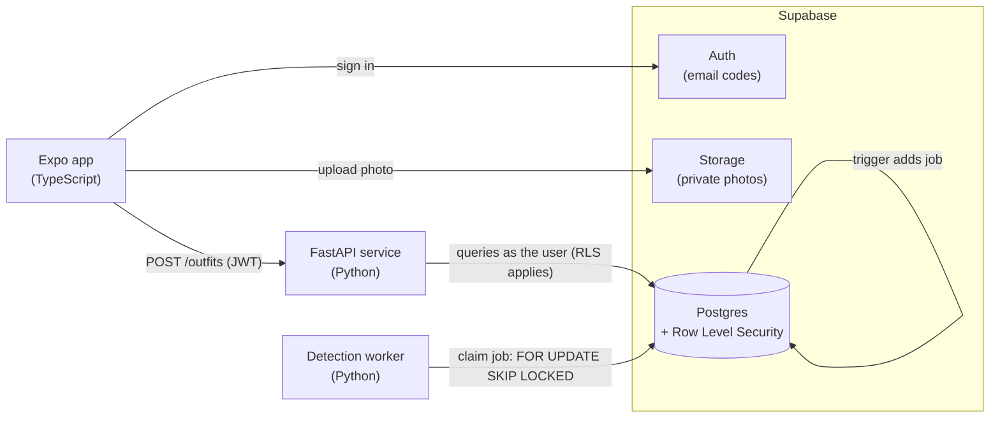

# Daily Fitted

A social outfit diary. Take one photo of your outfit each day, rank it against your past outfits with a few "better or worse?" taps, and share with friends. AI finds the items in each photo, so your closet fills itself.

> Status: early development. Sign-in and posting work; ranking, friends, and item detection are next.

## Architecture



| Folder | What's in it |
| --- | --- |
| [`apps/mobile`](apps/mobile) | Expo (React Native) app |
| [`services/api`](services/api) | FastAPI service and background worker |
| [`supabase`](supabase) | SQL migrations, privacy rules, and database tests |
| [`.github/workflows`](.github/workflows) | CI: lint, type checks, and tests for all three |

## Technical decisions

- **Supabase for solved problems, Python for the real logic.** Sign-in, file storage, and hosted Postgres come from Supabase. Business logic lives in a FastAPI service.
- **Privacy is enforced in the database.** Every table has Row Level Security. The API runs each request's queries *as the signed-in user* (`SET LOCAL ROLE authenticated` plus the verified JWT claims), so even a buggy API query can't return someone else's private rows. [`supabase/tests/rls.test.mjs`](supabase/tests/rls.test.mjs) proves the rules: strangers, pending requests, and blocked friends can't see outfits or photos.
- **Posting never waits on AI.** A database trigger adds a detection job in the same transaction as the outfit. Workers claim jobs with `SELECT ... FOR UPDATE SKIP LOCKED`, so many workers can run safely with no extra queue service. Failed jobs retry with exponential backoff, and jobs from crashed workers are picked up again.
- **Fast posting (goal: under 10 seconds).** The photo is shrunk and uploaded in the background as soon as it's taken, so tapping Post only waits for the last bit of the upload.
- **The sign-in session is encrypted on the phone.** A random AES-256 key is kept in the iOS Keychain, and the session is stored encrypted with AES-GCM ([`secure-session-storage.ts`](apps/mobile/src/lib/secure-session-storage.ts)).
- **Photos are private files.** They're stored by path in a private bucket and shown with signed URLs that expire after an hour.
- **Fractional ranking.** Outfits get a numeric `rank_key`. Inserting between two outfits uses their midpoint, so only one row changes.

## Getting started

You need: Node 22 (`.nvmrc`; e.g. `fnm use`), [uv](https://docs.astral.sh/uv/), a free [Supabase](https://supabase.com) project, and the Expo Go app on your phone.

**1. Database.** Link your Supabase project and apply the migrations:

```bash
npm install
npx supabase login
npx supabase link --project-ref YOUR_PROJECT_REF
npx supabase db push
```

Then in the Supabase dashboard, under **Authentication > Email Templates**, set both **Magic Link** and **Confirm signup** to show the code. Copy [`supabase/templates/sign_in_code.html`](supabase/templates/sign_in_code.html), which uses `{{ .Token }}`.

**2. API.** Copy `services/api/.env.example` to `services/api/.env`, fill it in, then:

```bash
cd services/api && uv sync && uv run dailyfitted-api
```

**3. App.** Copy `apps/mobile/.env.example` to `apps/mobile/.env`, fill it in, then:

```bash
cd apps/mobile && npm install && npx expo start
```

Scan the QR code with your phone's camera to open the app in Expo Go. Your phone and Mac must be on the same Wi-Fi.

## Tests

| Part | Command |
| --- | --- |
| Database privacy rules | `npm run test:db` (runs migrations in an in-process Postgres; no Docker) |
| API and worker | `cd services/api && uv run pytest` |
| App | `cd apps/mobile && npm run typecheck && npm run lint` |
